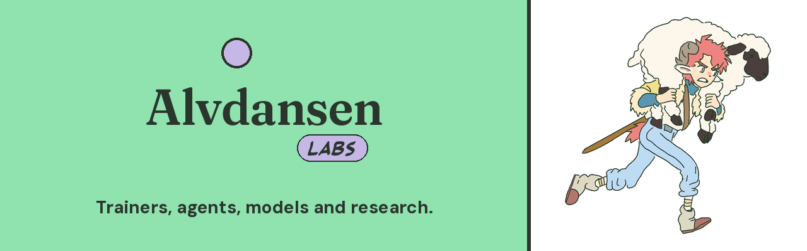

Open tools for artists who train. We build these for our own comic and animation work, then release them.
- Signet: video LoRA trainer with reference control built in (public beta)
- Flimmer: from raw footage to a trained video LoRA
- Vellum: production tracking and provenance for AI asset generation, as MCP tools
- Gridwatch: comparison grids for training runs
- ComfyUI Template Agent

Research: Animating on Twos, Full-shot anime generation, Forgetting on Purpose.
Models: huggingface.co/alvdansen · Letter: alvdansenlabs.substack.com
